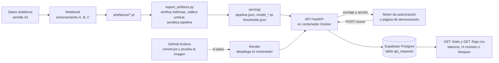

# Proyecto Final: Puntaje de riesgo de fraude transaccional en producción

Universidad del Valle · Deep Learning y Sistemas Inteligentes · 2026

**Integrantes:** Jonathan Zacarías (231104) · Luis [APELLIDO] (23353) · [TERCER INTEGRANTE]

**Servicio:** [ENLACE PÚBLICO] · **Presentación:** [`presentacion_final.pdf`](presentacion_final.pdf)
**Modelo de origen:** Proyecto 1, *Monitoreo Transaccional* (notebook `proyecto1_monitoreo_transaccional.ipynb`).

---

## 1. Problemática

**Problema.** Un banco debe decidir en línea, en milisegundos, qué hacer con cada transacción con tarjeta. Un fraude no detectado cuesta Q4,200 y un bloqueo injusto a un cliente legítimo cuesta Q180.

**Pregunta de investigación (Proyecto 1).** ¿El orden en que ocurren las transacciones aporta información que las variables agregadas no capturan, y cuánto vale eso en quetzales?

**Usuario.** El motor de autorización transaccional y los analistas de prevención de fraude.

**Decisión que depende del modelo.** Según el puntaje de riesgo: aprobar sin fricción, pedir autenticación reforzada (OTP o biometría) o bloquear la tarjeta y alertar a un analista.

**Alcance.** El servicio entrega un puntaje y una acción sugerida. No explica el patrón de fraude detectado.

## 2. Planificación

| Etapa | Fecha | Responsable | Estado |
|---|---|---|---|
| Elegir el Proyecto 1 y revisar notebook y contrato | 7 nov | [NOMBRE] | Hecho |
| Extraer el pipeline a un paquete y serializar escaladores y encoders | 7 nov | [NOMBRE] | Hecho |
| API (FastAPI), política de decisión y registro de uso | 7 nov | [NOMBRE] | Hecho |
| Verificar pesos y métricas con `export_artifacts.py` | [FECHA] | [NOMBRE] | [ESTADO] |
| Publicar el servicio | [FECHA] | [NOMBRE] | [ESTADO] |
| Pruebas con personas ajenas y capturas | [FECHA] | Todos | [ESTADO] |
| PDF de presentación y ensayo | [FECHA] | Todos | [ESTADO] |

Presentación: 9 de noviembre. Entrega límite: 15 de noviembre, 23:59.

## 3. Supuestos

**Datos**
- Son **sintéticos**: 1200 clientes, 90 días, semilla 42, con mecanismos de fraude inyectados (`probing_drainage`, `channel_velocity_shift`, `amount_spike`) y un caso legítimo difícil (`legit_travel_outlier`). No se probó con datos reales.
- Partición temporal: días 1-60 entrenamiento, 61-75 validación, 76-90 prueba. Escaladores y encoders se ajustan solo con entrenamiento.

**Costos y usuario**
- Costo de falso negativo Q4,200 y de falso positivo Q180, definidos en el Proyecto 1.
- El sistema que consume el servicio puede entregar las últimas transacciones del cliente (idealmente 6) y su monto promedio histórico.

**Entorno**
- Inferencia en CPU, una transacción por petición.
- Tiempos medidos en la máquina de pruebas del equipo, no en el servidor final.

## 4. Modelo planteado

**Proyecto de origen.** Proyecto 1. Tres modelos entrenados en PyTorch: A (MLP sobre 12 variables agregadas), B (LSTM con embeddings sobre las últimas K=6 transacciones) y C (red híbrida de dos ramas que combina B y A).

**Modelo en producción.** Apuesta C (`HybridDualBranchNet`). Se puede servir B con `MODEL=b` sin cambiar nada más.

**Cambios para producción** (no se reentrenó ningún modelo):

| Cambio | Motivo |
|---|---|
| Pipeline serializado (`serving/pipeline.json`: medias y escalas, vocabularios) | El notebook ajustaba todo en memoria. La API necesita las mismas transformaciones sin regenerar datos. |
| Variables calculadas en el servidor a partir de `recent_history` | El contrato original pedía 6 variables y el modelo usa 12. El cliente solo envía transacciones y, opcionalmente, `hist_avg_amount`. |
| Umbral de revisión = óptimo de validación del modelo servido; umbral de bloqueo 0,65 | El contrato original usaba 0,18, que no coincidía con el óptimo calibrado. El 0,65 viene del contrato original [CONFIRMAR]. |
| Se quitaron `detected_pattern` y `confidence` de la respuesta | Los modelos solo producen un puntaje; esos campos no tenían origen. |

**Limitaciones del modelo que conocemos** (encontradas al llevarlo a producción):
- `amount_to_hist_avg_ratio` quedó contaminada: la primera transacción de cada cliente tiene promedio histórico 0, lo que genera razones del orden de 10⁹ (1200 filas de 142 170 en entrenamiento). El escalador resultante tiene escala ≈ 1,4 × 10⁷, así que esa variable es prácticamente constante para el modelo. Afecta a la línea base A y a la rama agregada de C.
- En el notebook, las ventanas secuenciales de validación y prueba se construyen por separado: en el 16,6% de las transacciones de prueba (5997 de 36 185) la ventana queda cortada por el límite del periodo. En producción la ventana es completa, igual que en entrenamiento.

## 5. Validación de hipótesis

### 5.1 Hipótesis del modelo (Proyecto 1)

**Hipótesis.** El orden de las transacciones aporta valor: el modelo secuencial supera a las variables agregadas.
**Criterio de éxito** (tomado del notebook): ΔAUC-PR de C frente a A ≥ +0,05 y ahorro ≥ Q15 000 al mes (o 15%). [CONFIRMAR la fecha en que se definió, que debe ser anterior al entrenamiento.]

Resultados en prueba, tal como los reporta el Proyecto 1 [VERIFICAR con `serving/reproduced_metrics.json`]:

| Sistema | Umbral | AUC-PR | AUC-ROC | F1 | Recall | Precisión | Costo en prueba (15 días) |
|---|---|---|---|---|---|---|---|
| Ingenuo (A a 0,50) | 0,50 | 0,542 | 0,812 | 0,447 | 32,1% | 73,5% | Q114 840 |
| A (agregado) | 0,22 | 0,542 | 0,812 | 0,528 | 65,4% | 44,2% | Q91 140 |
| B (secuencial) | 0,20 | 0,836 | 0,958 | 0,768 | 83,2% | 71,3% | Q67 680 |
| C (híbrido) | 0,21 | 0,841 | 0,961 | 0,773 | 84,5% | 71,2% | Q67 020 |

- **Prueba de falsificación (permutación del orden):** según el informe del Proyecto 1, el AUC-PR de B cae 36,6% al barajar la secuencia.
- **Ahorro mensual frente a A:** B Q46 920 y C Q48 240 (la columna del informe original mezclaba bases).

**Hipótesis C frente a B.** La hipótesis declarada en el notebook pedía que C superara a B en "X puntos" de AUC-PR en validación, y X nunca se fijó. En prueba la mejora es de 0,005. No se sostiene con ningún umbral razonable, así que **B es una alternativa casi equivalente y más simple**. [DECIDIR Y EXPLICAR por qué se sirve C o B.]

### 5.2 Hipótesis de servicio

Criterios [FIJAR ANTES DE MEDIR y conservar la fecha]:

| Hipótesis | Métrica | Criterio de éxito | Resultado |
|---|---|---|---|
| La API puntúa igual que el notebook | Error máximo entre ambos | ≤ 1e-5 | [VALOR de `test_model_equivalence`] |
| La API construye las mismas variables | Error máximo en variables y ids | ≤ 1e-4, 0 ids distintos | **Cumplido:** 400 transacciones de prueba, error 0 |
| Los pesos reproducen lo reportado | AUC-PR de prueba frente al informe | Diferencia ≤ 0,02 | [VALOR de `export_artifacts`] |
| Latencia en línea | p95 de extremo a extremo | < 25 ms (contrato original) | [VALOR p95 local] / [VALOR en el servidor] |

### 5.3 Línea base

Sistema ingenuo (A sin calibrar, umbral 0,50) y A calibrado por costo. Para producción, la comparación relevante es el puntaje de la API frente al del notebook (5.2).

## 6. Herramientas y arquitectura



| Componente | Herramienta |
|---|---|
| Modelos | PyTorch (CPU) |
| API y página de demostración | FastAPI, Uvicorn |
| Empaquetado | Docker |
| Alojamiento | Render, plan gratuito (0,1 CPU y 512 MB), configurado en `render.yaml` |
| Integración y despliegue | GitHub Actions; Render despliega solo si las pruebas pasan |
| Registro y monitoreo | Supabase (Postgres), `GET /stats` y `GET /logs.csv` |

**Por qué Supabase para el registro.** El plan gratuito de Render borra los archivos locales cuando el servicio se duerme, se reinicia o se redespliega, y no admite discos persistentes. Sin una base externa, el registro de uso se perdería. Cada petición se guarda en segundo plano para no retrasar la respuesta; si la base falla, la API sigue respondiendo y solo se pierde esa fila. La tabla `api_requests` se crea sola y solo guarda datos operativos: hora, modelo, puntaje, decisión, latencia y tamaño del historial. No guarda `client_id` ni los montos.

**Monitoreo.**
- *Operativo:* latencia p50, p95 y máxima, errores 4xx y 5xx.
- *Deriva de puntajes:* proporción de transacciones enviadas a revisión o bloqueo y puntaje medio, contra lo observado en validación. Un cambio fuerte indica deriva de datos o de comportamiento.
- *Integridad:* repetir `test_model_equivalence` y `export_artifacts.py` tras cualquier cambio de versión de librerías.
- *Pendiente de producción real:* no hay etiquetas de fraude en tiempo real, así que no se puede medir AUC-PR en línea. Se necesitarían contracargos confirmados. [Definir umbrales de alerta y disparador de reentrenamiento.]

## 7. Evidencias del pase a producción

- **Servicio:** [ENLACE Y FECHA/HORA DE LA PRUEBA]
- **Capturas** (`evidencias/`): página de demostración con el ejemplo normal y el sospechoso, respuesta de `/health`, `/stats` tras varias peticiones, acceso desde un dispositivo ajeno al equipo.
- **Registro de uso:** `evidencias/requests.csv`, descargado de `GET /logs.csv` [N peticiones, % por decisión, latencia p50 y p95].
- **Pruebas:** `test_features_equivalence`, `test_model_equivalence`, `test_api`, `export_artifacts.py` [RESULTADOS Y CAPTURAS].
- **Prueba con persona ajena al equipo:** [NOMBRE, FECHA, QUÉ HIZO].

---

## Uso de la API

```powershell
Invoke-RestMethod -Uri http://localhost:8000/score -Method Post -ContentType 'application/json' `
  -InFile ejemplo_sospechoso.json
```

Respuesta:

```json
{
  "tx_id": "DEMO_SONDEO",
  "fraud_risk_score": 0.0,
  "decision": "BLOCK_TRANSACTION",
  "recommended_action": "LOCK_CARD_AND_ALERT_ANALYST",
  "model": "c",
  "review_threshold": 0.21,
  "block_threshold": 0.65,
  "latency_ms": 0.0,
  "history_used": 6,
  "warnings": []
}
```

(Los valores del ejemplo son ilustrativos.) `GET /ejemplos` devuelve dos peticiones de ejemplo; `GET /health` y `GET /stats` describen el estado del servicio, y `GET /logs.csv` descarga el registro de uso.

**Contrato de entrada.** `current_transaction` (obligatoria), `recent_history` (se recomiendan 6 transacciones previas, de más antigua a más reciente o en cualquier orden) y `aggregated_profile.hist_avg_amount` (opcional; si falta se estima con el historial recibido). Otros campos se ignoran. Si el historial tiene menos de 6 transacciones, la respuesta incluye una advertencia.

## Instrucciones de ejecución

```powershell
python -m venv .venv
.venv\Scripts\Activate.ps1
python -m pip install -r requirements-export.txt

# 1. Copiar aquí la carpeta artefactos/ del Proyecto 1 (modelo_a_baseline.pt, modelo_b_lstm.pt, modelo_c_hybrid.pt)
python export_artifacts.py --weights-dir artefactos --out serving

# 2. Pruebas
python -m tests.test_features_equivalence
python -m tests.test_model_equivalence
python -m tests.test_api

# 3. Servicio local (http://localhost:8000)
uvicorn api:app --port 8000

# 4. Docker
docker build -t fraude-api .
docker run -p 8000:8000 fraude-api

# 5. Comprobar un servicio en marcha, local o público
python scripts/smoke_test.py http://localhost:8000
python scripts/smoke_test.py https://SERVICIO.onrender.com --latency 100
```

Sin `DATABASE_URL`, el registro de uso se guarda en `logs/requests.csv`.

## Despliegue

1. En Supabase, crear un proyecto y copiar la cadena de conexión **Session pooler** (puerto 5432). La conexión directa solo funciona por IPv6 en el plan gratuito y Render usa IPv4. Agregar `?sslmode=require` al final.
2. En Render, elegir **New > Blueprint**, conectar el repositorio y pegar esa cadena cuando pida `DATABASE_URL`. Nunca debe subirse al repositorio.
3. Cada cambio en `main` pasa por GitHub Actions, y Render despliega solo si las pruebas pasan.
4. El servicio se duerme tras 15 minutos sin tráfico y tarda cerca de un minuto en despertar. Conviene abrirlo antes de una demostración.

**Estructura**

```
api.py                     API y página de demostración
export_artifacts.py        verifica pesos y exporta el paquete de servicio
fraude/features.py         datos sintéticos y pipeline (extraído del notebook sin cambios)
fraude/models.py           arquitecturas A, B y C (extraído del notebook sin cambios)
fraude/training.py         dataset, entrenamiento y métricas (extraído sin cambios)
fraude/request_features.py variables de la API (NumPy), equivalentes al pipeline
fraude/scoring.py          puntuación en línea
fraude/request_log.py      registro de uso (Postgres o CSV local)
tests/                     pruebas de equivalencia y de la API
scripts/smoke_test.py      prueba de extremo a extremo de un servicio en marcha
render.yaml                configuración del servicio en Render
.github/workflows/ci.yml   construye y prueba la imagen en cada cambio
serving/                   paquete de servicio (lo crea export_artifacts.py)
proyecto1_monitoreo_transaccional.ipynb   notebook original
```

## Uso de inteligencia artificial

**Proyecto 1.** Asistencia en visualizaciones, tablas y la formulación de costos asimétricos. Los autores verificaron el protocolo temporal, las pruebas de falsificación, los hiperparámetros y la interpretación financiera.

**Proyecto final.** Claude para extraer el pipeline del notebook, escribir la API, las pruebas, el Dockerfile y este README, y para revisar el notebook (de ahí salen las limitaciones de la sección 4). [AJUSTAR.] Cada integrante puede explicar el código y las decisiones.
