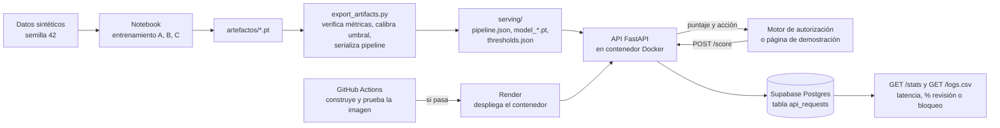

# Proyecto Final: Puntaje de riesgo de fraude transaccional en producción

Universidad del Valle · Deep Learning y Sistemas Inteligentes · 2026

**Integrantes:** Jonathan Zacarías (231104) · Luis Gilberto González (23353) · Diego López (23242)

**Servicio:** <https://fraude-api-t2ww.onrender.com> · **Presentación:** [`presentacion_final.pdf`](presentacion_final.pdf)
**Modelo de origen:** Proyecto 1, *Monitoreo Transaccional* (notebook `proyecto1_monitoreo_transaccional.ipynb`).

---

## 1. Problemática

**Problema.** Un banco debe decidir en línea, en milisegundos, qué hacer con cada transacción con tarjeta. Un fraude no detectado cuesta Q4,200 y un bloqueo injusto a un cliente legítimo cuesta Q180.

**Pregunta de investigación (Proyecto 1).** ¿El orden en que ocurren las transacciones aporta información que las variables agregadas no capturan, y cuánto vale eso en quetzales?

**Usuario.** El motor de autorización transaccional y los analistas de prevención de fraude.

**Decisión que depende del modelo.** Según el puntaje de riesgo: aprobar sin fricción, pedir autenticación reforzada (OTP o biometría) o bloquear la tarjeta y alertar a un analista.

**Alcance.** El servicio entrega un puntaje y una acción sugerida. No explica el patrón de fraude detectado.

## 2. Planificación

| Etapa | Fecha | Responsable | Estado |
|---|---|---|---|
| Elegir el Proyecto 1 y revisar notebook y contrato | 7 nov | Todos | Hecho |
| Extraer el pipeline a un paquete y serializar escaladores y encoders | 7 nov | Todos | Hecho |
| API (FastAPI), política de decisión y registro de uso | 7 nov | Todos | Hecho |
| Verificar pesos y métricas con `export_artifacts.py` | 8 nov | Jonathan Zacarías | Hecho |
| Registro persistente, integración continua y publicación en Render | 8 nov | Diego López | Hecho |
| Pruebas con personas ajenas y capturas | 13 nov | Todos | Hecho |
| PDF de presentación y ensayo | [FECHA] | Todos | [ESTADO] |

Presentación: 9 de noviembre. Entrega límite: 15 de noviembre, 23:59.

## 3. Supuestos

**Datos**
- Son **sintéticos**: 1200 clientes, 90 días, semilla 42, con mecanismos de fraude inyectados (`probing_drainage`, `channel_velocity_shift`, `amount_spike`) y un caso legítimo difícil (`legit_travel_outlier`). No se probó con datos reales.
- El generador usa `fraud_rate=0.035` por evento, pero un evento puede producir hasta 4 filas fraudulentas. Por eso entre 9,1% y 9,6% de las filas son fraude.
- Partición temporal: días 1-60 entrenamiento, 61-75 validación, 76-90 prueba. Escaladores y encoders se ajustan solo con entrenamiento.

**Costos y usuario**
- Costo de falso negativo Q4,200 y de falso positivo Q180, definidos en el Proyecto 1.
- El sistema que consume el servicio puede entregar las últimas transacciones del cliente (idealmente 6) y su monto promedio histórico.

**Entorno**
- Inferencia en CPU, una transacción por petición.
- Servicio en el plan gratuito de Render (0,1 CPU y 512 MB). Tras 15 minutos sin tráfico se duerme y tarda cerca de un minuto en despertar.

## 4. Modelo planteado

**Proyecto de origen.** Proyecto 1. Tres modelos entrenados en PyTorch: A (MLP sobre 12 variables agregadas, que representa el sistema actual del banco simulado), B (LSTM con embeddings sobre las últimas K=6 transacciones) y C (red híbrida de dos ramas que combina B y A).

**Modelo en producción.** B (`SequentialFraudLSTM`), por las razones de la sección 5.1. Se puede servir C con `MODEL=c` sin cambiar nada más.

**Cambios para producción** (no se reentrenó ningún modelo):

| Cambio | Motivo |
|---|---|
| Pipeline serializado (`serving/pipeline.json`: medias y escalas, vocabularios) | El notebook ajustaba todo en memoria. La API necesita las mismas transformaciones sin regenerar datos. |
| Variables calculadas en el servidor a partir de `recent_history` | El contrato original pedía 6 variables y el modelo usa 12. El cliente solo envía transacciones y, opcionalmente, `hist_avg_amount`. |
| Umbral de revisión = óptimo de validación del modelo servido; umbral de bloqueo 0,65 | La política del Proyecto 1 usaba 0,18, que no coincidía con el óptimo calibrado. El 0,65 viene de esa misma política y no se derivó de un análisis de costos. |
| Se quitaron `detected_pattern` y `confidence` de la respuesta | Los modelos solo producen un puntaje; esos campos no tenían origen. |

**Limitaciones del modelo que conocemos** (encontradas al llevarlo a producción):
- `amount_to_hist_avg_ratio` quedó contaminada: la primera transacción de cada cliente tiene promedio histórico 0, lo que genera razones del orden de 10⁹ (1200 filas de 142 170 en entrenamiento). El escalador resultante tiene escala ≈ 1,4 × 10⁷, así que esa variable es prácticamente constante para el modelo. Afecta a la línea base A y a la rama agregada de C.
- En el notebook, las ventanas secuenciales de validación y prueba se construyen por separado: en el 16,6% de las transacciones de prueba (5997 de 36 185) la ventana queda cortada por el límite del periodo. En producción la ventana es completa, igual que en entrenamiento. Con historial completo, B cuesta Q31 140 en prueba, frente a Q35 520 con las ventanas cortadas.
- Los puntajes están saturados: con historial completo, el 97,8% de los puntajes de B en prueba es menor que 0,001 o mayor que 0,999. El puntaje ordena el riesgo, pero no es una probabilidad calibrada.
- La política de tres niveles se comporta casi como una decisión binaria: en prueba, B aprueba el 90,2%, bloquea el 9,8% y solo envía el 0,02% a autenticación reforzada.

## 5. Validación de hipótesis

### 5.1 Hipótesis del modelo (Proyecto 1)

**Hipótesis.** El orden de las transacciones aporta valor: el modelo secuencial supera a las variables agregadas.
**Criterio de éxito** (tomado del notebook): ΔAUC-PR de C frente a A ≥ +0,05 y ahorro ≥ Q15 000 al mes (o 15%). Este criterio aparece en las conclusiones del notebook y no antes de entrenar, así que no se presenta como fijado de antemano. El informe del Proyecto 1 ya lo señalaba.

Resultados en prueba con los pesos de `artefactos/`. `export_artifacts.py` los reproduce y coinciden con `artefactos/metricas_completas.json`:

| Sistema | Umbral | AUC-PR | AUC-ROC | F1 | Recall | Precisión | Costo en prueba (15 días) |
|---|---|---|---|---|---|---|---|
| Ingenuo (A a 0,50) | 0,50 | 0,9811 | 0,9979 | 0,830 | 99,4% | 71,3% | Q333 300 |
| A (agregado) | 0,36 | 0,9811 | 0,9979 | 0,824 | 99,7% | 70,2% | Q308 820 |
| B (secuencial) | 0,01 | 0,9986 | 0,9998 | 0,985 | 99,9% | 97,1% | Q35 520 |
| C (híbrido) | 0,09 | 0,9986 | 0,9999 | 0,986 | 99,9% | 97,4% | Q33 180 |

- **Resultado frente al criterio:** el ΔAUC-PR de C frente a A es +0,018, menor que +0,05, así que esa parte **no se cumple**. El ahorro de C frente a A es de Q551 280 al mes, así que esa parte sí se cumple. Como el criterio exige ambas, la hipótesis **no se cumple tal como fue planteada**. Con B, el modelo servido, el resultado es el mismo: ΔAUC-PR de +0,018 y ahorro de Q546 600 al mes. El valor del modelo secuencial aparece en el costo: frente a A, B baja los falsos positivos de 1459 a 104 y los falsos negativos de 11 a 4.
- **Prueba de falsificación (permutación del orden):** al barajar la secuencia, el AUC-PR de B cae de 0,999 a 0,316 y el de C a 0,466.
- **Ahorro mensual frente a A:** B Q546 600 y C Q551 280.
- **Relación con el Proyecto 1.** Su informe reporta otra corrida del notebook, con un ahorro de B de Q641 520 al mes y la misma conclusión. Aquí se reportan los resultados de los pesos publicados, que son los que sirve la API.
- **Cómo leer estos números.** Los datos sintéticos son fáciles de separar: hasta el modelo agregado A llega a 0,98. Estos resultados no anticipan el desempeño con datos reales.

**Hipótesis C frente a B.** La hipótesis declarada en el notebook pedía que C superara a B en "X puntos" de AUC-PR en validación, y X nunca se fijó. En prueba, la mejora de AUC-PR es de 0,00001. En costo, B gana en validación (Q19 140 frente a Q26 820) y C gana en prueba (Q33 180 frente a Q35 520); son diferencias de pocos casos. 

**Decisión: se sirve B.** Un modelo se elige con validación, no con prueba, y en validación B tiene el menor costo. Los dos empatan en AUC-PR de prueba, y B es más simple: no usa la rama agregada, afectada por la variable contaminada de la sección 4. La ventaja de C en prueba, de Q2 340, equivale a pocos casos y no puede usarse para elegir. **Riesgo aceptado:** el umbral óptimo de B (0,01) está en el mínimo de la búsqueda, así que B es sensible a cambios pequeños en los puntajes. Por eso se vigila la proporción de bloqueos en `GET /stats`.

### 5.2 Hipótesis de servicio

Origen de los criterios: la latencia viene del contrato original del Proyecto 1. Las tolerancias de equivalencia (1e-5 y 1e-4) están en el código de las pruebas desde el 7 de noviembre, antes de correrlas. El umbral de AUC-PR (≤ 0,02) se fijó el 8 de noviembre junto con la medición, así que no se presenta como fijado de antemano.

| Hipótesis | Métrica | Criterio de éxito | Resultado |
|---|---|---|---|
| La API puntúa igual que el notebook | Error máximo entre ambos | ≤ 1e-5 | **Cumplido:** 150 transacciones por modelo, error 5,96e-08, con pesos aleatorios de semilla fija |
| La API construye las mismas variables | Error máximo en variables y ids | ≤ 1e-4, 0 ids distintos | **Cumplido:** 400 transacciones de prueba, error 0 |
| Los pesos reproducen lo reportado | AUC-PR de prueba frente al informe | Diferencia ≤ 0,02 | **Cumplido.** Frente a `metricas_completas.json`, diferencia 0. Frente al informe del Proyecto 1, diferencia máxima de 0,0005 |
| Latencia en línea | p95 de extremo a extremo | < 25 ms (contrato original) | **No cumplido:** 371 ms desde Guatemala hasta Render (50 peticiones, 8 nov 2026). El modelo por sí solo tarda 1,4 ms en p95 |

### 5.3 Línea base

Sistema ingenuo (A sin calibrar, umbral 0,50) y A calibrado por costo. Para producción, la comparación relevante es el puntaje de la API frente al del notebook (5.2).

## 6. Herramientas y arquitectura



| Componente | Herramienta |
|---|---|
| Modelos | PyTorch (CPU) |
| API y página de demostración | FastAPI, Uvicorn |
| Empaquetado | Docker |
| Alojamiento | Render, plan gratuito (0,1 CPU y 512 MB), configurado en `render.yaml` |
| Integración y despliegue | GitHub Actions; Render despliega solo si las pruebas pasan |
| Registro y monitoreo | Supabase (Postgres), `GET /stats` y `GET /logs.csv` |

**Por qué Supabase para el registro.** El plan gratuito de Render borra los archivos locales cuando el servicio se duerme, se reinicia o se redespliega, y no admite discos persistentes. Sin una base externa, el registro de uso se perdería. Cada petición se guarda en segundo plano para no retrasar la respuesta; si la base falla, la API sigue respondiendo y solo se pierde esa fila. La tabla `api_requests` se crea sola y solo guarda datos operativos: hora, modelo, puntaje, decisión, latencia y tamaño del historial. No guarda `client_id` ni los montos.

**Monitoreo.**
- *Operativo:* latencia p50, p95 y máxima, errores 4xx y 5xx.
- *Deriva de puntajes:* proporción de transacciones enviadas a revisión o bloqueo y puntaje medio, contra lo observado en validación. Un cambio fuerte indica deriva de datos o de comportamiento.
- *Integridad:* repetir `test_model_equivalence` y `export_artifacts.py` tras cualquier cambio de versión de librerías.
- *Pendiente de producción real:* no hay etiquetas de fraude en tiempo real, así que no se puede medir AUC-PR en línea. Se necesitarían contracargos confirmados.

**Umbrales de alerta propuestos** (referencia: en prueba, B aprueba el 90,2% y bloquea el 9,8%). Se calculan sobre las últimas 500 peticiones, sin contar las pruebas automáticas:

| Señal | Alerta si |
|---|---|
| Proporción de revisión o bloqueo | sale del rango 5%–15% |
| Proporción de autenticación reforzada | supera el 2% (en prueba fue 0,02%; un aumento indica puntajes menos saturados) |
| Latencia del modelo (`latency_ms`), p95 | supera 25 ms (hoy 1,4 ms) |
| Errores 5xx | más del 1% de las peticiones |

**Disparador de reentrenamiento.** Una alerta de deriva que se mantenga 7 días seguidos, o, cuando haya contracargos confirmados, un recall menor que 95% o un costo semanal mayor que el de validación escalado al mismo volumen. Reentrenar implica volver a calibrar el umbral de revisión y repetir las pruebas de equivalencia antes de desplegar.

## 7. Evidencias del pase a producción

- **Servicio:** <https://fraude-api-t2ww.onrender.com>, verificado el 8 de noviembre de 2026 a las 21:37, hora de Guatemala, con `scripts/smoke_test.py`.
- **Capturas** (`evidencias/`, tomadas del servicio público el 13 de noviembre de 2026 a las 10:28, hora de Guatemala):
  - `01_pagina_ejemplo_normal.png`: "Cliente habitual", puntaje 0,0000, **Aprobar**.
  - `02_pagina_ejemplo_sospechoso.png`: "Sondeo y vaciado", puntaje > 0,9999, **Bloquear**, 1,00 ms de cálculo.
  - `03_health.png`: `{"status":"ok","model":"b","review_threshold":0.01,"block_threshold":0.65}`.
  - `04_stats.png`: 217 peticiones acumuladas, incluidas las pruebas automáticas; latencia del modelo p50 1,3 ms y p95 2,0 ms.
  - `05` a `07` (`*_ajeno_*.png`): acceso desde la laptop de una persona ajena al equipo; ver el punto siguiente.
- **Registro de uso:** `evidencias/requests.csv`, descargado de `GET /logs.csv` el 13 de noviembre de 2026 a las 10:51, hora de Guatemala. Tiene 247 filas. Las primeras 178 (8 de noviembre, 21:05 a 21:37) son pruebas automáticas del despliegue, incluidas corridas con el modelo C, y no se cuentan como uso.
  - *Uso real* (filas 179 a 247, del 8 al 13 de noviembre, todas con el modelo B): **69 peticiones**. Aprobar 27 (39,1%), autenticación reforzada 13 (18,8%) y bloquear 29 (42,0%). Todas llegaron con 6 transacciones de historial.
  - *Latencia del modelo* (`latency_ms`, sin la red): p50 1,24 ms, p95 5,34 ms, máximo 390 ms en una petición tras despertar el servicio.
  - La proporción de bloqueos (42%) es mucho mayor que el 9,8% de prueba porque casi todo el uso fue la página de demostración, cuyos ejemplos se eligieron para mostrar las tres decisiones. No es una señal de deriva.
- **Pruebas:** `test_features_equivalence`, `test_model_equivalence`, `test_api` y `test_real_weights` pasan. La última carga los pesos reales de `serving/` y comprueba por HTTP que `ejemplo_normal.json` da `APPROVE` y `ejemplo_sospechoso.json` da `BLOCK_TRANSACTION`, con los tres modelos (puntajes 0,000000 y 0,999999 con B). `export_artifacts.py` reproduce `metricas_completas.json`. La imagen de Docker pasa en [GitHub Actions](https://github.com/Zacatac23/ProyectoFinalDeepLearning/actions) con los límites de Render (0,1 CPU y 512 MB) y un Postgres de prueba.
- **Prueba con persona ajena al equipo:** Mateo Sandoval, 13 de noviembre de 2026 por la mañana, en su laptop (Windows 11, Google Chrome). Solo se le dijo que era un sistema de un banco que decide si una compra con tarjeta es fraude.
  - *Qué hizo:* evaluó "Cliente habitual" (Aprobar, puntaje 0,0000) y "Sondeo y vaciado" (Bloquear, > 0,9999). En este último bajó el monto de la compra actual de Q4 500 a Q100,54, quitó la marca de internacional y volvió a evaluar: el sistema la aprobó con puntaje 0,0000. Capturas `05`, `06` y `07`.
  - *Qué entendió:* que el verde significa que la compra se parece a lo que el cliente gasta normalmente, y por qué se bloqueó la segunda (varias compras en una hora, monto alto y fuera del país). Notó que al bajar el monto la misma compra pasa.
  - *Qué le confundió:* el nombre "Sondeo y vaciado" le pareció técnico hasta ver el resultado. El mensaje "Acierto: era fraude y el modelo lo bloquea" le hizo dudar si la respuesta estaba programada de antemano o si se calculaba en ese momento. Y la frase "no es la explicación del modelo" le pareció contradictoria, porque justo debajo se listan motivos.
  - *Lo que sacamos de la prueba:*
    - La página debería aclarar que la etiqueta "Acierto" compara con la respuesta conocida del dato sintético y que el puntaje sí se calcula en el momento.
    - Los nombres de los ejemplos necesitan una explicación corta.
    - El cambio que hizo muestra algo del modelo: con los mismos 4 cargos pequeños en una hora, la compra final se aprueba si es pequeña y nacional. El sondeo por sí solo no basta para que B la marque.

---

## Uso de la API

```powershell
Invoke-RestMethod -Uri http://localhost:8000/score -Method Post -ContentType 'application/json' `
  -InFile ejemplo_sospechoso.json
```

Respuesta:

```json
{
  "tx_id": "DEMO_SONDEO",
  "fraud_risk_score": 0.999999,
  "decision": "BLOCK_TRANSACTION",
  "recommended_action": "LOCK_CARD_AND_ALERT_ANALYST",
  "model": "b",
  "review_threshold": 0.01,
  "block_threshold": 0.65,
  "latency_ms": 1.026,
  "history_used": 6,
  "warnings": []
}
```

`latency_ms` mide solo el cálculo de variables y del modelo, sin la red. `GET /` abre la página de demostración: dibuja la secuencia de compras, permite editarla y trae 9 ejemplos con puntajes distintos, incluidos un falso positivo y un fraude no detectado. `GET /ejemplos` devuelve esas peticiones y `GET /catalogo` las mismas con su contexto; `GET /health` y `GET /stats` describen el estado del servicio, y `GET /logs.csv` descarga el registro de uso.

**Contrato de entrada.** `current_transaction` (obligatoria), `recent_history` (se recomiendan 6 transacciones previas, de más antigua a más reciente o en cualquier orden) y `aggregated_profile.hist_avg_amount` (opcional; si falta se estima con el historial recibido). Otros campos se ignoran. Si el historial tiene menos de 6 transacciones, la respuesta incluye una advertencia.

## Instrucciones de ejecución

```powershell
python -m venv .venv
.venv\Scripts\Activate.ps1
python -m pip install -r requirements-export.txt

# 1. Exportar el paquete de servicio desde los pesos de artefactos/
python export_artifacts.py --weights-dir artefactos --out serving

# 2. Pruebas
python -m tests.test_features_equivalence
python -m tests.test_model_equivalence
python -m tests.test_api
python -m tests.test_real_weights

# 3. Servicio local (http://localhost:8000)
uvicorn api:app --port 8000

# 4. Docker
docker build -t fraude-api .
docker run -p 8000:8000 fraude-api

# 5. Comprobar un servicio en marcha, local o público
python scripts/smoke_test.py http://localhost:8000
python scripts/smoke_test.py https://SERVICIO.onrender.com --latency 100
```

Sin `DATABASE_URL`, el registro de uso se guarda en `logs/requests.csv`.

## Despliegue

1. En Supabase, crear un proyecto y copiar la cadena de conexión **Session pooler** (puerto 5432). La conexión directa solo funciona por IPv6 en el plan gratuito y Render usa IPv4. Agregar `?sslmode=require` al final.
2. En Render, elegir **New > Blueprint**, conectar el repositorio y pegar esa cadena cuando pida `DATABASE_URL`. Nunca debe subirse al repositorio.
3. Cada cambio en `main` pasa por GitHub Actions, y Render despliega solo si las pruebas pasan.
4. El servicio se duerme tras 15 minutos sin tráfico y tarda cerca de un minuto en despertar. Conviene abrirlo antes de una demostración.

**Estructura**

```
api.py                     API (FastAPI)
web/                       página de demostración (index.html) y ejemplos (ejemplos.json)
export_artifacts.py        verifica pesos y exporta el paquete de servicio
fraude/features.py         datos sintéticos y pipeline (extraído del notebook sin cambios)
fraude/models.py           arquitecturas A, B y C (extraído del notebook sin cambios)
fraude/training.py         dataset, entrenamiento y métricas (extraído sin cambios)
fraude/request_features.py variables de la API (NumPy), equivalentes al pipeline
fraude/scoring.py          puntuación en línea
fraude/request_log.py      registro de uso (Postgres o CSV local)
tests/                     pruebas de equivalencia y de la API
scripts/smoke_test.py      prueba de extremo a extremo de un servicio en marcha
render.yaml                configuración del servicio en Render
.github/workflows/ci.yml   construye y prueba la imagen en cada cambio
serving/                   paquete de servicio (lo crea export_artifacts.py)
proyecto1_monitoreo_transaccional.ipynb   notebook original
```

## Uso de inteligencia artificial

Se usaron asistentes de IA para programar y revisar la API, las pruebas y la configuración de despliegue, y para revisar las métricas y redactar la documentación. Las decisiones de alcance, modelo e infraestructura fueron del equipo.

